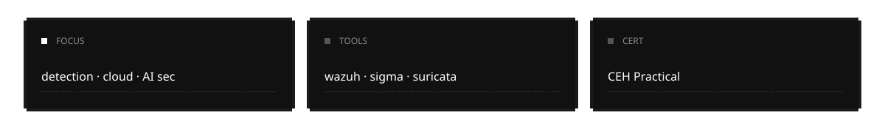
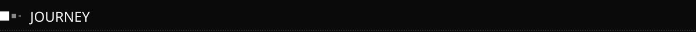
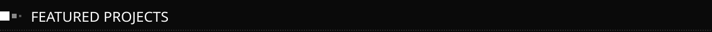
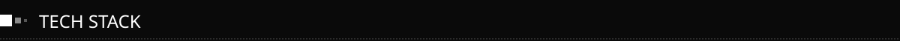

<div align="center">


<a href="https://hustlerx.si"></a>&nbsp;&nbsp;&nbsp;

</div>

<a id="about"></a>


> Security engineer in **Pune, India**, working on detection, cloud and AI security.

I build small security tools, test them, and write down what they missed.



```bash
ansar@hustlerx:~$ cat about.txt
name      : Ansar Shaikh
location  : Pune, India
education : Sinhgad Institute of Technology & Science (SPPU), Pune
            B.E. IT, Cybersecurity honours, 2021-2025, CGPA 8.38
certs     : CEH Practical (EC-Council)
looking   : SOC / detection engineering, cloud security, AI security roles
```

<a id="journey"></a>


<div align="center">

</div>

<details>
<summary><sub>&nbsp;view as table</sub></summary>

| When | What |
|:---:|:---|
| 2021 | Joined Sinhgad Institute of Technology & Science (SPPU), Pune: B.E. Information Technology, Honours in Cybersecurity |
| May – Jun 2024 | ServiceNow System Administrator virtual internship (AICTE) |
| Jul 2025 | Graduated B.E. IT, Cybersecurity honours, CGPA 8.38, no backlogs |
| Aug 2025 → now | CTF Player and Security Researcher, Hack The Box & TryHackMe |
| Oct 2025 | CEH Practical, EC-Council |

</details>

<a id="projects"></a>


#### `SOC & DETECTION`

| Project | Result | What it is |
|---|---|---|
| [siem-lab](https://github.com/hustlerx01/siem-lab) | 5/5 Suricata rules fired | Wazuh and Suricata in Docker with custom rules mapped to MITRE ATT&CK, replayed against public EVTX attack samples and a generated pcap. |
| [detection-rules-as-code](https://github.com/hustlerx01/detection-rules-as-code) | 16/16 TP, 0/16 FP | 10 Sigma rules, each with true- and false-positive sample events, a linter and a CI gate. |
| [soc-honeypot-lab](https://github.com/hustlerx01/soc-honeypot-lab) | 112 TP, 0 FP, 30 FN | Honeypot log lab with Sentinel-style detections written as KQL, Sigma and Python that run locally, scored against labelled synthetic events. |
| [phishdesk-in](https://github.com/hustlerx01/phishdesk-in) | SPF, DKIM, DMARC + UPI lures | Explains why an .eml looks like phishing: header authentication checks plus Indian bank and UPI lure rules, tested on 69 synthetic lab emails. |

#### `VAPT & APPSEC`

| Project | Result | What it is |
|---|---|---|
| [webvuln-scanner](https://github.com/hustlerx01/webvuln-scanner) | Flags TLS 1.0/1.1, weak cookies | CLI that checks security headers, cookie flags and TLS on sites you own and grades them. |
| [secure-shortener](https://github.com/hustlerx01/secure-shortener) | OWASP Top 10, 24 tests | URL shortener where every control maps to an OWASP Top 10 category with a named test. |
| [api-qa-suite](https://github.com/hustlerx01/api-qa-suite) | 6/6 seeded defects caught | Security and functional tests for an API with 6 seeded OWASP API Top 10 defects: 9 tests fail on the vulnerable build, all 28 pass on the fixed one. |
| [secrets-leak-guard](https://github.com/hustlerx01/secrets-leak-guard) | 10 TP, 0 FP, 0 FN | gitleaks rules for Indian formats (Razorpay keys, Aadhaar), a pre-commit hook that blocked a staged token, and a history scan. |
| [vulnops](https://github.com/hustlerx01/vulnops) | 355 findings to 185 | Merges Trivy, Grype and ZAP output, removes cross-tool duplicates and ranks by CISA KEV, EPSS and CVSS. |

#### `AI SECURITY`

| Project | Result | What it is |
|---|---|---|
| [rag-redteam](https://github.com/hustlerx01/rag-redteam) | Injection success 3/8 to 1/8 | Indirect prompt-injection tests against a local RAG app on qwen2.5:1.5b with three defences. |
| [mcp-audit-lite](https://github.com/hustlerx01/mcp-audit-lite) | 19 findings, 0 on clean servers | Static scanner for MCP server manifests and source: tool poisoning, hardcoded secrets, shell=True and risky permissions. |
| [indicguard](https://github.com/hustlerx01/indicguard) | Hindi and Marathi injections | Prompt-injection detection for Hindi, Hinglish and Marathi input. |
| [llm-redactor](https://github.com/hustlerx01/llm-redactor) | Found and fixed a card regex bug | FastAPI middleware that redacts PII and secrets, including PAN, UPI and IFSC, from LLM output. |

**Also built:** [hardened-aws-web-tier](https://github.com/hustlerx01/hardened-aws-web-tier), [mini-cspm-aws](https://github.com/hustlerx01/mini-cspm-aws), [k8s-policy-pack](https://github.com/hustlerx01/k8s-policy-pack), [iac-scan-bench](https://github.com/hustlerx01/iac-scan-bench), [signed-by-default](https://github.com/hustlerx01/signed-by-default), [slo-lab](https://github.com/hustlerx01/slo-lab), [bluegreen-deploy](https://github.com/hustlerx01/bluegreen-deploy), [chaos-kit](https://github.com/hustlerx01/chaos-kit), [log-pipeline-lab](https://github.com/hustlerx01/log-pipeline-lab), [spring-secure-api](https://github.com/hustlerx01/spring-secure-api), [pcap-hunter](https://github.com/hustlerx01/pcap-hunter), [ioc-aggregator](https://github.com/hustlerx01/ioc-aggregator)

<a id="experience"></a>


| When | What |
|---|---|
| Aug 2025 → now | **CTF Player and Security Researcher**, [Hack The Box](https://www.hackthebox.com/) & [TryHackMe](https://tryhackme.com/) |
| May – Jun 2024 | ServiceNow System Administrator virtual internship (AICTE) |

| Certification | Issuer | Date |
|---|---|---|
| Certified Ethical Hacker (CEH) Practical | EC-Council | Oct 2025 |
| arcX Foundation Threat Intelligence Analyst | arcX | Mar 2025 |
| Certified AppSec Practitioner (CAP) | The SecOps Group | Mar 2024 |
| Microsoft Azure Fundamentals (AZ-900) | Microsoft | Feb 2024 |

<a id="stack"></a>


**Languages**  
    

**Frameworks**  
   

**Cloud & IaC**  
   

**Containers & CI/CD**  
      

**Security & Detection**  
        

**Observability**  
   

**Platforms**  
 

<a id="stats"></a>


<div align="center">

&nbsp;


</div>


<a id="contact"></a>


<div align="center">
<table><tr>
<td align="center" width="96"><a href="https://hustlerx.si"><br/><sub><b>website</b></sub></a></td>
<td align="center" width="96"><a href="https://www.linkedin.com/in/hustlerx"><br/><sub><b>linkedin</b></sub></a></td>
<td align="center" width="96"><a href="https://github.com/hustlerx01"><br/><sub><b>github</b></sub></a></td>
<td align="center" width="96"><a href="mailto:ansarshaikh@hustlerx.si"><br/><sub><b>email</b></sub></a></td>
<td align="center" width="96"><a href="https://discord.com/users/974323061547479120"><br/><sub><b>discord</b></sub></a></td>
</tr></table>
</div>


